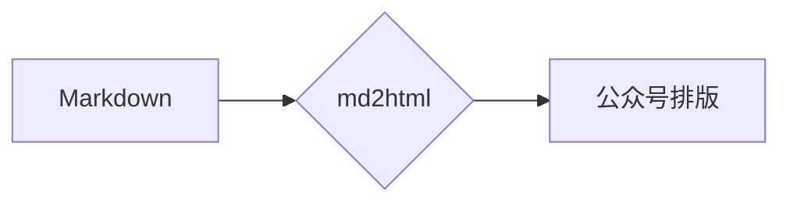

# md2html-rs

[md2html](https://github.com/xinchen/md2html)（Node.js 版）的 Rust 实现：Markdown → 微信公众号排版 HTML 的 CLI 工具，主题化、样式全内联、粘贴不丢格式。设计与方案见 [docs/DESIGN.md](docs/DESIGN.md)。

同一套渲染管线与结构约定（`parse → transform → render` 纯函数管线、6 套主题、全内联 style、无 class/id），单文件静态二进制，无运行时依赖。

## 使用

```bash
cargo install --path .   # 安装命令 md2html

md2html article.md                  # → article.html（预览页，含头卡；页脚默认不追加）
md2html article.md -t moyu --open   # 指定主题并自动打开预览
md2html article.md --footer         # 需要时追加文末一键三连页脚
md2html article.md -w --open        # 监听变更实时重新生成
md2html ui article.md -t deepblue   # 浏览器编辑器：编辑+实时预览+⌘S保存+一键复制
md2html article.md --stdout         # 仅输出正文 HTML 片段（管道友好）
md2html article.md --no-header      # 连头卡也不渲染
md2html --list-themes               # 查看可用主题
```

「复制到公众号」与 `publish` 草稿**自动剔除头卡**（公众号标题走后台标题栏）；一键三连页脚默认不追加，`--footer` 或 frontmatter `footer: true` 开启后视为正文内容一并复制/发布。

浏览器编辑器（`md2html ui`）：左编辑右预览、主题即时切换（记忆在浏览器）、⌘S 保存回原文件、"复制到公众号"一键富文本复制；mermaid 图表在编辑器里同样实时渲染成图（走本地服务 `/api/render`、`/api/mermaid`，与 CLI 产出一致）；服务仅绑定 127.0.0.1，只读写启动时指定的那个文件。

可用主题（6 套）：`moyu` 摸鱼绿 / `redwhite` 红白色系 / `deepblue` 深海蓝（默认）/ `orange` 活力橙 / `grape` 暗夜紫 / `peach` 蜜桃粉。

### Mermaid 图表

````markdown

````

转换时自动渲染成图片内嵌（data URI，单文件自包含）：引擎优先本地 `mmdc`（`npm i -D @mermaid-js/mermaid-cli`，支持主题色联动文章配色；查找顺序 `MD2HTML_MMDC` 环境变量 → `./node_modules/.bin` → `PATH`），未装则走 mermaid.ink 在线渲染，都失败时保留主题色代码卡兜底。`--mermaid off` 关闭。

## 发布到公众号草稿箱（一行命令）

```bash
# 首次配置凭据（公众号后台「设置与开发 → 基本配置」获取，IP 白名单需包含本机出口 IP）
echo '{ "appid": "你的AppID", "secret": "你的AppSecret" }' > ~/.md2html/config.json
# 或环境变量：export MD2HTML_APPID=xxx MD2HTML_SECRET=xxx

md2html publish article.md -t deepblue             # 渲染 → 图片转存 → 写入草稿箱（不群发）
md2html publish article.md --cover ./cover.png     # 指定封面（默认取文内第一张图）
md2html publish article.md --author 歆晨 --digest "摘要"
```

- 正文图片自动转存微信（支持外链 URL、本地相对路径、data URI）；草稿不允许外链图，这是必须步骤；
- 元数据支持 frontmatter：`title / author / digest / cover / theme / date / header / footer`，优先级 CLI 参数 > frontmatter > 自动兜底（标题取 h1/文件名，摘要取首段前 120 字）；
- **草稿正文自动剥离头卡**（与复制按钮一致）；页脚默认不追加，`--footer` 开启后会随草稿发布；
- 需要**已认证**账号（未认证个人订阅号一般没有草稿/素材接口权限，报 48001 就是这个原因）；群发永远手动，在后台完成。

## 开发

```bash
cargo test                      # 单测 + 集成 + 快照 + CLI 冒烟
UPDATE_SNAPSHOTS=1 cargo test   # 结构有意变更后更新快照
cargo build --release           # 单文件二进制 target/release/md2html
```

结构（与 JS 版一一对应）：

| 模块 | 职责 |
|---|---|
| `src/parse.rs` | markdown-rs（remark 的 Rust 移植）→ mdast，GFM 开启 |
| `src/transform.rs` | h1→标题卡、h2 编号、连续图→图集、mermaid 标记、页脚注入 |
| `src/render.rs` | 组件分发表 + 全部块级/行内组件，样式 100% 内联 |
| `src/highlight.rs` | syntect 高亮，按主题 codeTokens 色板构建，逐行 span |
| `src/themes.rs` | 6 套主题 = 纯色板数据，共享默认字体/圆角/间距/代码配色 |
| `src/preview.rs` | 预览页壳（677px + 复制按钮） |
| `src/mermaid.rs` | mmdc → mermaid.ink → 代码卡兜底，data URI 内嵌 |
| `src/ui/` | 本地编辑器服务（tiny_http）+ 内嵌页面/脚本 |
| `src/wechat.rs` `src/publish.rs` `src/config.rs` | 草稿箱发布链路 |
| `src/main.rs` | clap CLI 薄壳 |

技术选型说明：

- **markdown-rs** 与 JS 版同源（wooorm 的 micromark/remark 移植），AST 节点类型一一对应；
- **syntect**（regex-fancy 纯 Rust 正则）替代 lowlight/highlight.js：按主题色板动态构建高亮主题，逐行 span 输出，行结构在公众号不丢；
- 高亮配色为 VSCode Dark+ 风格（与 JS 版快照同为深色代码卡），Rust 版快照独立维护，不与 JS 版逐字节对齐。

## 与 JS 版的差异

- `md2html ui` 的渲染在**服务端**完成（`POST /api/render`）：JS 版 core 可在浏览器直跑，Rust 版 core 在本机进程内——编辑器体验不变；
- mermaid 本地引擎查找基于环境变量/cwd/PATH（Rust 无 module 目录概念）；
- 其余行为（主题、结构约定、复制剥离、frontmatter 优先级、发布流程、错误码提示）与 JS 版保持一致。
