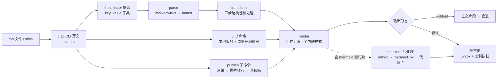
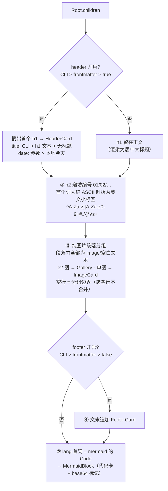
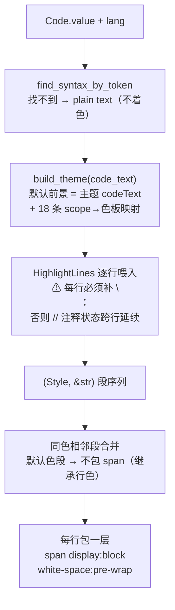
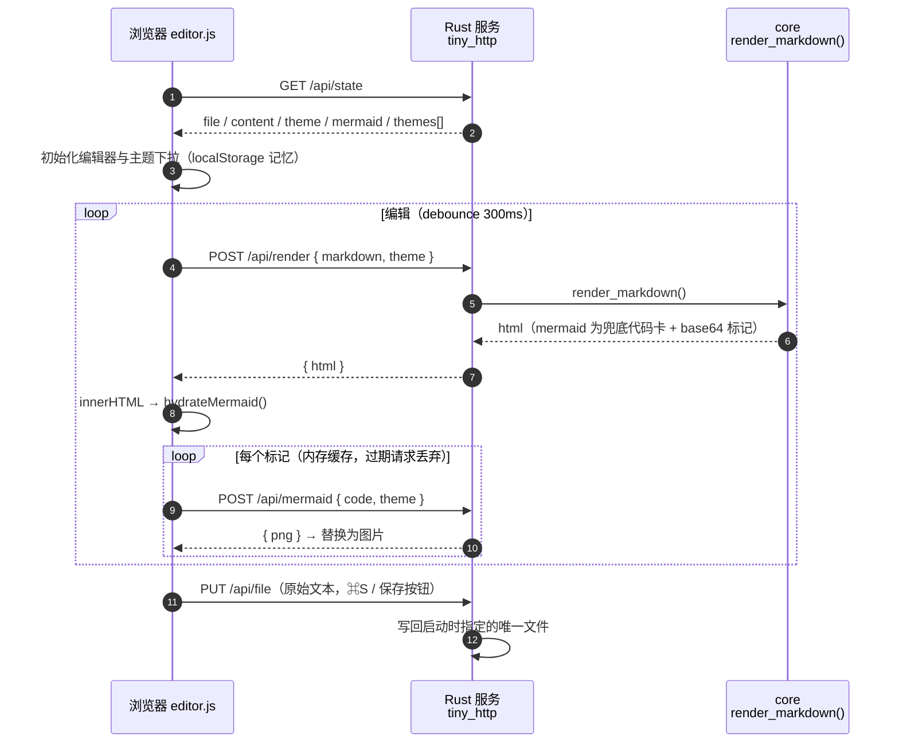
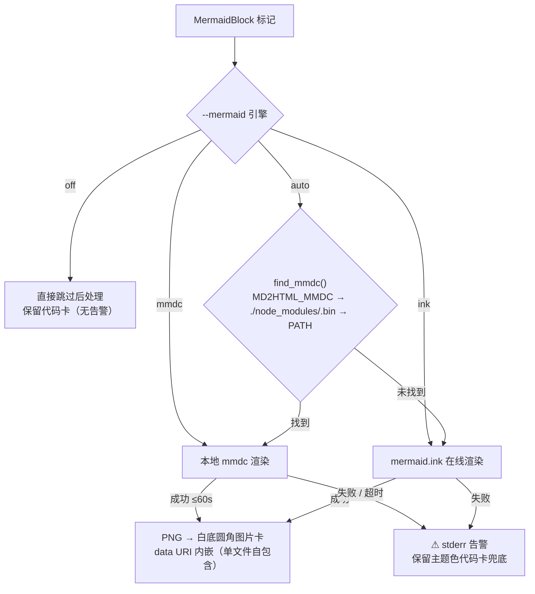
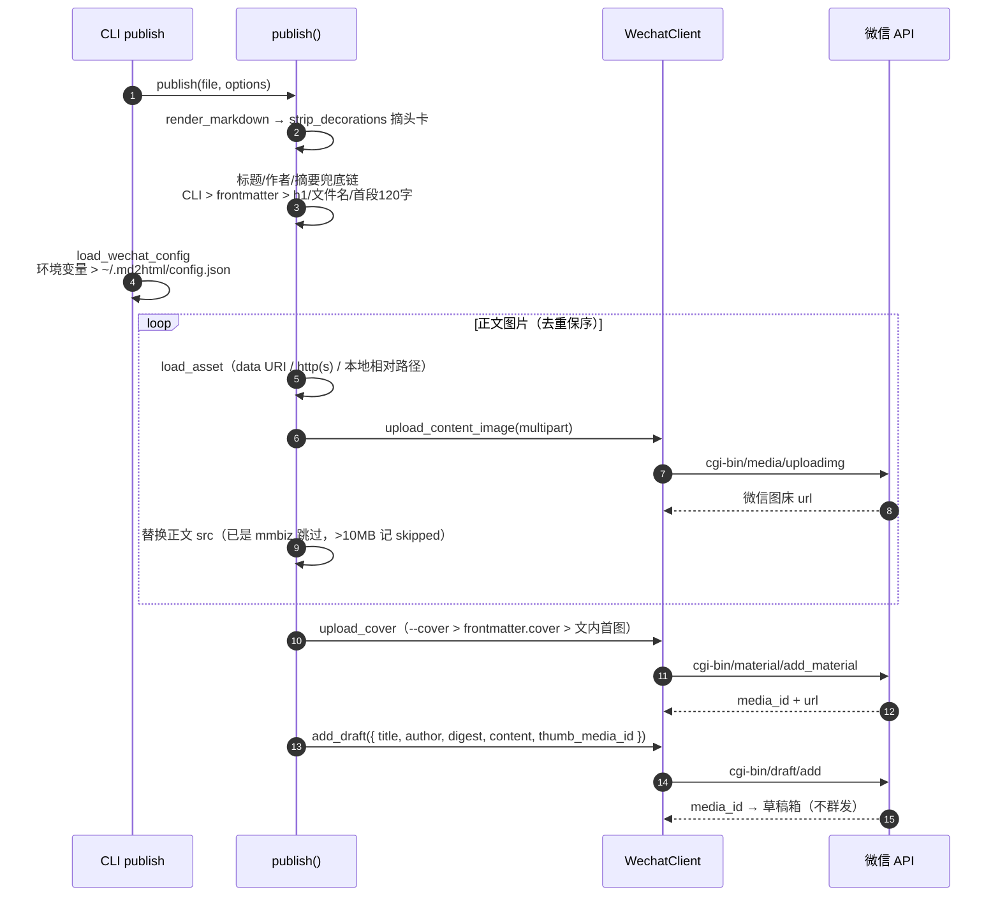
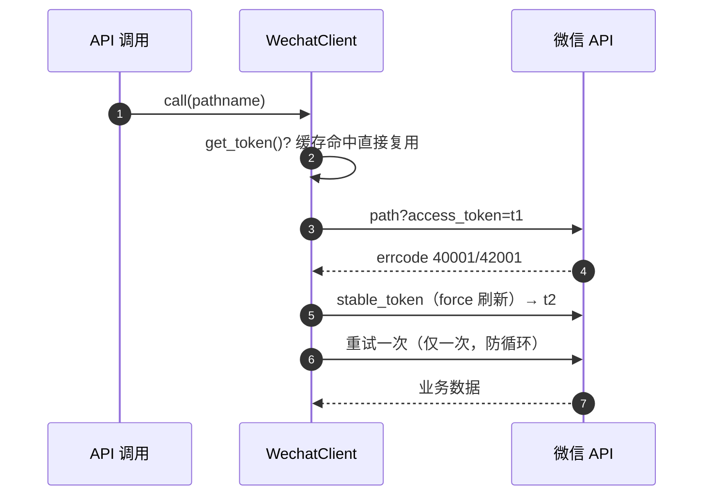
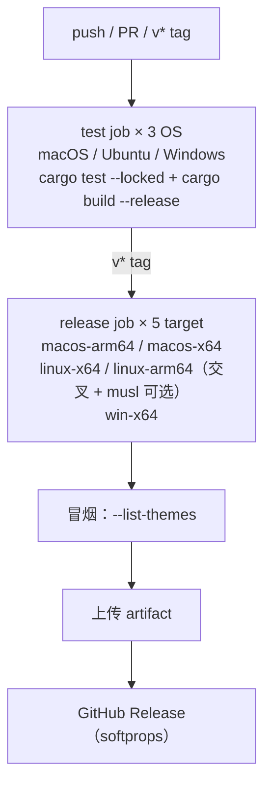

# md2html-rs 开发设计方案

> Markdown → 微信公众号排版 HTML 的 CLI 工具（Rust 实现）。本文档是 [md2html](../../../md2html)（Node.js 版）同构实现的权威设计：主题化、样式全内联、可直接复制粘贴发布；附浏览器编辑器与公众号草稿箱发布链路。
>
> 行为约定与 JS 版保持一致（组件结构、主题色板、frontmatter 优先级、复制剥离规则），差异集中在语言形态带来的两处适配（见 [§17 与 JS 版差异对照](#17-与-js-版差异对照)）。

---

## 目录

1. [目标与非目标](#1-目标与非目标)
2. [语言与技术选型](#2-语言与技术选型)
3. [总体架构与数据流](#3-总体架构与数据流)
4. [目录结构](#4-目录结构)
5. [渲染管线设计](#5-渲染管线设计)
6. [组件规格（验收对照表）](#6-组件规格验收对照表)
7. [主题系统](#7-主题系统)
8. [代码高亮](#8-代码高亮)
9. [CLI 设计](#9-cli-设计)
10. [预览页与复制机制](#10-预览页与复制机制)
11. [UI 编辑器](#11-ui-编辑器)
12. [Mermaid 图表渲染链路](#12-mermaid-图表渲染链路)
13. [发布链路（publish）](#13-发布链路publish)
14. [错误处理哲学](#14-错误处理哲学)
15. [测试策略](#15-测试策略)
16. [CI 与发布](#16-ci-与发布)
17. [与 JS 版差异对照](#17-与-js-版差异对照)
18. [关键决策记录](#18-关键决策记录)
19. [已知限制与公众号白名单附录](#19-已知限制与公众号白名单附录)

---

## 1. 目标与非目标

**目标**

- CLI 一条命令把 `.md` 转成公众号可直接粘贴的 HTML（样式全内联，粘贴不丢格式）；
- 与 JS 版**同一套输出契约**：6 套主题、组件结构、头卡/页脚剥离标记完全一致，两版产物可互相替换；
- 单文件静态二进制（release ≈ 5MB，LTO + strip），无运行时依赖，交叉编译覆盖 macOS(x64/arm64) / Linux(x64/arm64) / Windows(x64)；
- 浏览器编辑器（`ui` 子命令）与草稿箱发布（`publish` 子命令）全功能对齐。

**非目标**

- 不做公众号 API 直接**群发**（仅到"一行命令进草稿箱"；群发永远手动）；
- 不做多人协作、云同步、账号体系；
- 不做 Word/PDF 导出、数学公式（与 JS 版二期节奏同步）；
- 不追求与 JS 版输出**逐字节一致**（高亮引擎不同，快照独立维护；结构约定一致即可）。

**运行时零 LLM**：整条链路是确定性规则转换，不调用任何模型 API。

---

## 2. 语言与技术选型

| 项 | 选型 | 理由 |
|---|---|---|
| 语言 | Rust 2021 edition | 单文件静态产物、无 GC 抖动；核心渲染是纯 CPU 字符串处理，Rust 的所有权模型天然适配"树遍历 + 字符串拼接"管线 |
| Markdown 解析 | `markdown` 1.0（markdown-rs） | **wooorm micromark/remark 的 Rust 移植**，与 JS 版 remark-parse 同源同规范；直接产出标准 mdast（`Node` 枚举），GFM 表格/任务列表/删除线/字面自动链接开箱即用。比 pulldown-cmark 的事件流模型更贴合"AST 级结构变换"的需求 |
| 代码高亮 | `syntect` 5（regex-fancy） | Sublime 语法引擎，常见语言覆盖全；`regex-fancy` 纯 Rust 正则免 C 依赖（交叉编译友好）。按主题色板**动态构建高亮主题**，保持"主题色驱动代码配色"的架构性质 |
| CLI | `clap` 4（derive） | 子命令 + 派生宏自文档化；`-h` 自动生成 |
| 本地服务 | `tiny_http` 0.12 | ui 编辑器用；成熟、极小、阻塞模型够用（单用户本地场景） |
| HTTP 客户端 | `ureq` 2（rustls） | mermaid.ink / 图片下载 / 微信 API；阻塞式与 CLI 形态匹配，rustls 免系统 OpenSSL |
| JSON | `serde` + `serde_json` | 微信 API 与 ui 服务协议 |
| 文件监听 | `notify` 6 | `--watch` 跨平台 FS 事件 |
| 日期 | `chrono` | 头卡日期需**本地时区**（`09 OCT 2026`），手写 days-algorithm 在 +08:00 深夜会差一天 |
| base64 / tempfile / dirs | 0.22 / 3 / 5 | mermaid 标记与 data URI、mmdc 临时目录、`~/.md2html` 定位 |

**依赖共 11 个生产依赖**，全部为纯 Rust 或 rustls 后端，交叉编译无 C 工具链要求（onig 已通过 feature 关闭）。

**为什么核心数据结构用 mdast 而不是自定义 AST**：`markdown` 的 `mdast::Node` 与 JS 版 remark 的节点一一对应（`Heading/ListItem.checked/Table.align/Code.lang`…），transform 的五条规则可以逐条照搬；自定义节点（头卡/图集/页脚）只在**根层**引入 `Block` 包装枚举，嵌套层级保持原生 mdast，避免整棵树重造。

---

## 3. 总体架构与数据流

```
core 三铁律（与 JS 版相同）：
1. core 是纯函数：render_markdown(md, options) → { html, theme, meta }，不碰文件系统；
2. 样式 100% 内联：正文无 <style>/<script>/class/id，每块样式都在 style 属性上；
3. 结构性效果在 AST 层做：编号/图集/页脚/高亮行结构，不依赖 CSS 计数器与 grid。
```



三条消费路径（convert / ui / publish）共用同一个 `render_markdown` 纯函数，差异只在输入输出壳层。

---

## 4. 目录结构

```
md2html-rs/
├── Cargo.toml              # bin 名 md2html；release: lto + strip
├── src/
│   ├── main.rs             # CLI 薄壳：convert / ui / publish 三形态 + watch
│   ├── lib.rs              # render_markdown()：唯一入口（纯函数）
│   ├── parse.rs            # markdown-rs → mdast（GFM constructs）
│   ├── frontmatter.rs      # 极简 key: value 提取（不引 YAML 依赖）
│   ├── transform.rs        # Block 枚举 + 五步预处理
│   ├── render.rs           # 组件分发表 + 全部块级/行内组件
│   ├── highlight.rs        # syntect 主题构建 + 逐行 token 段
│   ├── themes.rs           # 6 套主题 = 纯色板数据 + 共享默认变量
│   ├── preview.rs          # 预览页壳（677px + 复制按钮）
│   ├── mermaid.rs          # 标记扫描 + mmdc/ink 渲染 + data URI 替换
│   ├── open_browser.rs     # darwin open / win start / linux xdg-open
│   ├── config.rs           # 凭据加载：环境变量 > ~/.md2html/config.json
│   ├── wechat.rs           # 微信 API 客户端（token 缓存 + 强刷重试）
│   ├── publish.rs          # 发布编排：图片转存 → 封面 → draft/add
│   ├── utils.rs            # esc / s / format_date / strip_decorations / node_text
│   └── ui/
│       ├── mod.rs          # tiny_http 路由：/, editor.js, api/state|render|mermaid|file
│       ├── page.html       # 内嵌编辑器页（include_str!）
│       └── editor.js       # 内嵌脚本：防抖渲染 / hydrate / ⌘S / 复制
├── tests/
│   ├── fixtures/sample.md  # 元素齐全的验收样例（与 JS 版同一份）
│   ├── __snapshots__/      # 6 主题快照（Rust 版独立基准；不入库，cargo test 自动生成）
│   ├── render.rs           # 快照 + 渲染行为集成测试
│   └── cli.rs              # 二进制冒烟测试（CARGO_BIN_EXE）
└── .github/workflows/build.yml
```

---

## 5. 渲染管线设计

### 5.1 入口签名

```rust
// lib.rs —— 与 JS 版 renderMarkdown(md, themeId, options) 等价
pub fn render_markdown(md: &str, options: &RenderOptions) -> Result<RenderResult, String>

pub struct RenderOptions {
    pub theme:  Option<String>,   // 主题 id
    pub title:  Option<String>,   // 显式标题
    pub date:   Option<String>,   // 头卡日期（测试固定快照用）
    pub header: Option<bool>,     // None = 交给 frontmatter/默认（true）
    pub footer: Option<bool>,     // None = 交给 frontmatter/默认（false）
}

pub struct RenderResult {
    pub html:  String,             // 全内联正文（最外层 root <section>）
    pub theme: &'static Theme,     // 命中的主题（含色板）
    pub meta:  ArticleMeta,        // title/date/author/digest/cover
}
```

`header/footer` 用 `Option<bool>` 三态：`None` 表示"CLI 未表态"，让 frontmatter 决定——对应 JS 版 cac 缺省 `undefined` 的语义（`--footer` 缺席时 frontmatter `footer: true` 仍生效）。

### 5.2 frontmatter（`frontmatter.rs`）

- 只支持 `key: value` 字符串/布尔子集，与 JS 版正则 `^([A-Za-z_][\w-]*)\s*:\s*(.*)$` 行为一致；键统一小写；
- 值剥首尾各一个引号；`true/false` 以 `bool_of()` 惰性解释；
- 未闭合的 `---` 块视为无 frontmatter（与 JS 非贪婪正则的失败行为一致）；
- 支持键：`title / date / theme / header / footer / author / digest / cover`。

**优先级**：CLI 参数 > frontmatter > 默认值。

### 5.3 parse（`parse.rs`）

```rust
markdown::to_mdast(md, &ParseOptions::gfm())   // constructs.frontmatter 保持 false：
                                               // frontmatter 已在上游剥掉，
                                               // 正文中的 --- 仍是普通分割线（同 remark 无插件形态）
```

### 5.4 transform（`transform.rs`）

输入输出均为树；根层节点被提升为自定义 `Block` 枚举，嵌套层保持 mdast：

```rust
pub enum Block {
    Mdast(Node),                                    // 未命中的原生节点
    HeaderCard  { title, date },                    // ① 文首标题卡
    Heading2    { children, no, label },            // ② h2 编号 + 英文标签
    Gallery     { images: Vec<Node> },              // ③ 同段落 ≥2 图
    ImageCard   { image: Image },                   // ③ 单图段落
    FooterCard,                                     // ④ 三连页脚
    MermaidBlock { code, original: Code },          // ⑤ mermaid 代码块
}
```



为什么必须在 AST 层做：公众号编辑器会剥掉 class，CSS 计数器、grid、伪元素全部失效——编号、图集、页脚必须是**真实 DOM 结构**。

### 5.5 render（`render.rs`）

递归遍历 + 按类型分发的组件表；递归上下文与 JS 版 `deriveCtx` 的 patch 字段一一对应：

```rust
struct Ctx<'a> {
    vars: &'a Vars,        // 主题变量
    in_quote: bool,        // 金句卡内：strong 高亮底纹、段落居中
    tight: bool,           // 列表项内：段落 margin 收紧
    task_done: bool,       // 已勾任务：正文置灰
    list_depth: usize,     // 嵌套层级：>0 时列表加 margin-left:1.5em
}
```

- 块级容器一律 `<section>`，文本叶节点用 `<span>`；
- 布局用内联 `display:flex`（mdnice 路线验证可在粘贴中存活）；
- 工具函数 `s(&[("key","value")])` 序列化 style（kebab-case，空值跳过）；全部插值文本经 `esc()` 转义；
- 防御性兜底：未被 transform 命中的 h2（理论上不存在）按 h3 形态渲染，不 panic；
- 原生 HTML 片段（`html` 节点）直接丢弃——避免未内联标签混进公众号。

---

## 6. 组件规格（验收对照表）

| Markdown 元素 | 输出结构约定（配合主题变量） |
|---|---|
| h1（文首） | 浅色渐变圆角卡（`linear-gradient(135deg, accentLight, #FFF)`）：日期小字 + 大号粗体标题 + 主题色短下划线；带 `data-md2html-block="header"` 剥离标记 |
| h2 | 自动编号：主题色特大号数字 `01` + 灰色小字母间距英文标签（可选）+ 黑色粗体标题 |
| h3 | 主题色左侧竖条（4×16px）+ 粗体 |
| h4+ | 主题色粗体，15px |
| 段落 p | 15px / 行高 1.75 / 两端对齐 / `overflow-wrap:break-word`；段间距取 `spacing.paragraph` |
| strong | 主题色加粗；金句卡内改为「黄色底纹渐变高亮」 |
| em | 常规斜体 |
| 行内代码 | 主题色浅底圆角 `<code style>` |
| 代码块 | 深色圆角卡（`codeBg`）+ 逐行 `<span style="display:block">`；`white-space:pre-wrap;word-break:break-all` 防溢出；syntect 着色内联（见 §8） |
| blockquote（金句卡） | `1.5px dashed accent` 虚线圆角卡、居中粗体 |
| 有序列表 | 浅底圆角卡 + 主题色圆形序号（支持 `start` 偏移） |
| 无序列表 | 主题色圆点（6px）；嵌套逐级缩进 1.5em |
| 任务列表 | ☑/☐ 字符 + 勾选置灰删除线（GFM checked） |
| 表格 | 真实 `<table>` 内联边框，表头主题色浅底，**任意列数保持表格形态**（2026-09-26 决策：不做宽表卡片降级）；单元格 `overflow-wrap` 防长词 |
| 分割线 | 居中短粗主题色横条（40×4px，非全宽 hr） |
| 单图 | 圆角图卡 + 底部灰色小字题注（`— alt —`） |
| 图集（连续≥2 图） | flex 网格每行 2 张，间距 6px |
| 链接 | **降级为主题色文字 + 下划线，不输出 `<a>`**（多数个人号无外链权限） |
| 删除线 | 灰色 `line-through` |
| 页脚 | 居中提示语 + 👍点赞/👀在看/🔁转发 三张浅底小卡；带 `data-md2html-block="footer"` 标记 |

---

## 7. 主题系统

**原则不变：共享一套渲染器，主题 = 变量数据。加主题不碰渲染器。**

```rust
pub struct Theme { id, name, description, vars: Vars }
pub struct Vars { font: Font, radius: Radius, spacing: Spacing, colors: Colors }
```

- 6 套主题只覆盖 `Colors` 十色；`font/radius/spacing` 走 `DEFAULT` 常量（编译期 `const fn theme()` 构造，零运行时合并逻辑——JS 版注册时需要 deep-merge + 缺键校验，Rust 用类型系统在编译期保证变量完整，`Colors` 缺字段直接编译失败）；
- 代码配色 `codeTokens` 是全主题共享的 VSCode Dark+ 色板（常量表，见 §8）；
- `--list-themes` 遍历静态数组输出；
- 未知主题报错并列出可用 id（`未知主题 "x"，可用主题: moyu, …`）。

首发 6 套色板与 JS 版逐值相同：摸鱼绿 `#07C160` / 红白 `#E34D59` / 深海蓝 `#2A6AE9`（默认）/ 活力橙 `#F76B1C` / 暗夜紫 `#7C5CFC` / 蜜桃粉 `#EC6E8B`。

已知的有意差异：6 套主题的 `muted` 均比 JS 版深（原值白底对比度仅 2.4~2.7:1，日期/标签/题注等 12px 小字难以辨认），统一加深至 WCAG AA 白底 ≥4.5:1，色相不变：摸鱼绿/红白 `#9CA3AF→#6B7280`、深海蓝 `#9AA6B2→#64748B`、活力橙 `#B0A49A→#82705F`、暗夜紫 `#A29BB3→#766C8C`、蜜桃粉 `#B39AA2→#83696F`。

---

## 8. 代码高亮

JS 版用 lowlight（highlight.js）输出 class 再映射色板；Rust 版用 syntect 直接输出着色 token 段，映射思路等价：



**scope → 色板映射**（Sublime 作用域 → VSCode Dark+ 语义色，specific 规则后置覆盖 generic）：

| Sublime scope | 色板 | 颜色 |
|---|---|---|
| `comment` | comment | `#6A9955` |
| `keyword` | keyword | `#C586C0` |
| `storage`（let/const/function） | literal | `#569CD6` |
| `constant.numeric` | number | `#B5CEA8` |
| `constant.language` / `variable.language` | literal | `#569CD6` |
| `entity.name.function` / `support.function` | function | `#DCDCAA` |
| `entity.name.type/class` / `support.type/class` | type | `#4EC9B0` |
| `entity.name.tag` | tag | `#569CD6` |
| `entity.other.attribute-name` | attribute | `#9CDCFE` |
| `support.constant` | built_in | `#4EC9B0` |
| `string.regexp`（后置覆盖） | regexp | `#D16969` |
| `string`（generic，先匹配） | string | `#CE9178` |

**跨行 token**：`HighlightLines` 在多次 `highlight_line` 调用间保持解析状态，多行字符串/注释颜色自然延续（对应 JS 版手写颜色栈）。工程坑已记录：**每行必须以 `\n` 结尾喂给解析器**，否则 `//` 行注释状态会延续到下一行——这是行级 API 与状态机的语义边界。

输出契约与 JS 版一致：空行渲染 `&nbsp;` 占位，行 span 固定 `display:block;white-space:pre-wrap;word-break:break-all;color:codeText`，保证公众号粘贴后行结构不丢。

---

## 9. CLI 设计

```
md2html <FILES>...          转换一个或多个 md 文件（'-' 读 stdin）
md2html ui [FILE]           浏览器编辑器
md2html publish <FILE>      发布到公众号草稿箱
```

| 参数（convert） | 说明 |
|---|---|
| `-t, --theme <name>` | 主题 id；缺省时 frontmatter `theme` > deepblue |
| `-o, --out <file>` | 输出路径（单文件有效，默认同名 `.html`） |
| `--stdout` | 仅输出正文 HTML 片段（管道友好，不落预览壳） |
| `--open` | 生成后自动打开预览页（首个产物） |
| `--no-header` | 不渲染文首标题卡 |
| `--footer` | 追加一键三连页脚（缺席 = frontmatter 决定） |
| `--mermaid <engine>` | auto / ink / mmdc / off，默认 auto |
| `-w, --watch` | 监听单文件变更（notify + 200ms 防抖），与 `--stdout`/stdin 互斥 |
| `--list-themes` | 列出主题 |
| `-h / -V` | 帮助 / 版本 |

- 多文件批量：每个输入产同名 `.html`；`-o` 仅单文件时生效（与 JS 版一致）；
- 进度与错误走 **stderr**，正文片段走 **stdout**——`md2html a.md --stdout | pbcopy` 干净可用；
- 三态开关的实现：`--footer` 出席 → `Some(true)`，缺席 → `None`（放行 frontmatter）。

---

## 10. 预览页与复制机制

预览页 = 极简壳 + 正文（`preview.rs`，与 JS 版逐字对应）：

- 灰底居中白色内容列，宽度 **677px**（公众号正文实际渲染宽度，所见即所得）；
- 右下悬浮「复制到公众号」按钮：克隆正文 → 摘除 `[data-md2html-block="header"]` → `Range.selectNodeContents()` + `document.execCommand('copy')` 写入 **text/html** 富文本 → 公众号后台 ⌘V；
- 壳内 `<style>/<script>` 属于预览层，永远不会进入复制内容与 `--stdout` 输出；
- `strip_decorations()`（publish 用）按嵌套深度扫描配对 `</section>` 摘除整块，不依赖正则贪婪匹配——与客户端按 attribute 选择器摘除是同一约定的两个实现。

---

## 11. UI 编辑器

`md2html ui [file]` 启动本地服务（仅绑定 `127.0.0.1:0` 随机端口），只读写启动时指定的那一个文件，不接受任意路径。

页面：左侧 textarea（Tab 缩进支持）+ 右侧预览（677px）、主题下拉（localStorage 记忆）、字数统计、⌘S 保存、「复制到公众号」（复制剥离规则与预览页一致，见 §10：摘除头卡，标题走公众号后台标题栏）。



**与 JS 版的结构性差异**：JS 版 core 是浏览器可直跑的 ESM，预览在客户端渲染；Rust 版 core 在本机进程内，预览改走 `POST /api/render` 服务端渲染。对外体验不变（debounce 后 ~ms 级返回），编辑器逻辑（缓存、过期丢弃、兜底形态替换）逐点保留。`--mermaid off` 时 `/api/mermaid` 返回 400，客户端保留代码卡。

请求体上限：通用 10MB、mermaid 端点 128KB（超限 413）。

---

## 12. Mermaid 图表渲染链路

渲染层先输出**兜底形态**：`<section data-md2html-mermaid="{base64}">主题色代码卡</section>`；后处理（`mermaid.rs::inline_mermaid`）扫描标记、逐块渲染 PNG、`replace_range` 整块替换为图片卡（从后往前，避免下标位移）。



- **主题联动**：mmdc 传 `--themeVariables`（primaryColor=accentLight、lineColor=accent、textColor=text…），图与文章配色一致；
- **mermaid.ink 细节**（JS 版踩坑延续）：URL-safe base64 且去 padding；源码必须以换行结尾否则 400；不带单独 scale 参数；UA 标识 + 60s 超时；
- mmdc 超时 60s：`try_wait` 轮询 + 超时 kill（std 无自带 timeout）；
- `data URI` 内嵌保证 HTML 单文件自包含；publish 场景后续可复用图片管线转存微信（TODO）。

---

## 13. 发布链路（publish）



**token 生命周期**（`wechat.rs`）：



- multipart 手工构造（boundary + Content-Disposition），不引表单依赖；
- 错误码中文映射 17 条（48001 无权限、40164 IP 白名单、40013 AppID…），`WechatError` 统一 `[code] 提示（errmsg）` 格式；
- 发布报告：标题、media_id、转存张数、跳过清单（含原因）、凭据来源，全部走 stderr。

---

## 14. 错误处理哲学

- **core 不 panic**：`render_markdown` 返回 `Result`；markdown 解析失败在理论不可达（markdown-rs 对任意输入产树），仍以 `expect` 契约化；
- **可操作报错**：凭据缺失直接给出两种配置方法与复制粘贴兜底命令；未知主题列出可用项；mermaid 引擎非法列出可选项；
- **降级而不是失败**：mermaid 渲染失败保留代码卡并告警；图片 >10MB 记 skipped 继续发布；单图失败不影响整篇；
- **CLI 退出码**：成功 0，任何失败 1；进度/告警/错误全部 stderr，stdout 保持纯净。

---

## 15. 测试策略

与 JS 版同构：**快照让回归验证不需要人眼**。

| 层 | 内容 | 位置 |
|---|---|---|
| 单测 | esc/s 序列化、strip_decorations、frontmatter、五步 transform（编号/图集/空行边界/头尾卡）、高亮颜色、主题表、微信 token 刷新（假 TCP 服务注入 api_base）、multipart、publish 图片收集、ui 服务端到端（state/render/save/mermaid-off） | `src/**` 内嵌 `#[cfg(test)]` |
| 快照 | `sample.md`（元素齐全样例）× 6 主题，固定 `date: 22 SEP 2026`；`UPDATE_SNAPSHOTS=1 cargo test` 重新生成；对比前归一化 CRLF | `tests/__snapshots__/` |
| 行为 | 无 class/id/style/script、代码逐行 span 带色、表格保持形态、长词保护、嵌套列表、空文档兜底、头尾标记与剥离、`--no-header` 居中 h1、frontmatter 优先级、mermaid 标记、链接降级 | `tests/render.rs` |
| CLI 冒烟 | `CARGO_BIN_EXE_md2html` 直跑二进制：list-themes、落盘预览页、stdout 纯净、stdin、frontmatter 主题生效、未知主题报错 | `tests/cli.rs` |

测试对网络无依赖：微信用假 TCP 服务、mermaid.ink 不进单测（ink 链路靠真实冒烟覆盖）。

---

## 16. CI 与发布

`.github/workflows/build.yml`：



- 交叉编译仅 linux-arm64 需要 `gcc-aarch64-linux-gnu` 链接器，其余目标原生构建；
- `rust-cache` 加速；`--locked` 保证 Cargo.lock 一致；
- 本地打包即 `cargo build --release`（lto + strip，产物 ≈5MB）。

---

## 17. 与 JS 版差异对照

| 维度 | JS 版 | Rust 版 | 影响 |
|---|---|---|---|
| 输出契约 | — | **完全一致** | 两版产物可互换，主题/结构/剥离标记同约定 |
| 代码高亮引擎 | lowlight（highlight.js class 映射） | syntect scope 映射 | token 切分粒度不同 → 快照独立维护；配色同为 VSCode Dark+ 风格 |
| ui 渲染位置 | core 浏览器直跑 | `POST /api/render` 服务端渲染 | 体验不变（本地回环）；编辑器脚本多了 fetch 层 |
| mmdc 定位 | 相对模块目录 `../node_modules/.bin` | `MD2HTML_MMDC` → cwd `./node_modules/.bin` → `PATH` | Rust 无 module 目录概念；PATH 查找更符合独立二进制形态 |
| `--mermaid off` | 引擎校验抛错被 catch → 告警 + 代码卡 | 后处理入口直接跳过（无告警） | 行为超集，语义更干净 |
| 主题完整性校验 | 注册时运行时 deep-merge + 缺键报错 | 类型系统编译期保证（`const fn` 构造） | 运行时零校验成本 |
| 三态 CLI 选项 | cac 缺省 undefined | `--footer` 出席/缺席 → `Some(true)`/`None` | 语义对齐 |
| 二进制 | pkg 打包 ~40MB+ | cargo release ≈5MB，交叉编译原生支持 | 分发成本显著更低 |

---

## 18. 关键决策记录

- **2026-10-09 选型 markdown-rs 而非 pulldown-cmark**：前者与 JS 版 remark 同源、直接产 mdast，transform 五规则可逐条照搬；pulldown-cmark 事件流需要自建树，反而多一层。
- **2026-10-09 syntect regex-fancy 关闭 onig**：交叉编译免 C 工具链；fancy-regex 覆盖常用语法集（js/ts/rust/bash/python/json…）。
- **2026-10-09 逐行喂 syntect 必须补 `\n`**：行级 API 靠换行复位行内状态（行注释/字符串），否则状态跨行延续把下一行染成注释色。已写进 §8 与代码注释。
- **2026-10-09 `header/footer` 三态 `Option<bool>`**：CLI 缺席 ≠ false，否则 frontmatter `footer: true` 会被 CLI 默认值覆盖，破坏 JS 版优先级语义。
- **2026-10-09 ui 渲染走服务端**：Rust core 无法进浏览器；本地回环延迟可忽略，换取与 CLI **严格同一**渲染引擎（比 JS 版"浏览器直跑同构"更强的一致性保证）。
- **2026-10-09 高亮快照独立**：不追求与 JS 版逐字节一致；结构约定一致 + 视觉风格一致即可，避免为对齐字节做脆弱的 hack。

---

## 19. 已知限制与公众号白名单附录

**已知限制**

- 外链图片粘贴时常被屏蔽：使用可公网访问的图床；publish 链路会自动转存规避；
- `data:` URI（mermaid 除外，publish 转存后替换）、内联 SVG、`position/float`、CSS 计数器、外部字体：一律不用；
- `<a>` 对多数个人号无效 → 已按"主题色文字"降级；
- 公众号编辑器偶尔对粘贴内容二次清洗：首发前每主题人工 checklist 必过（6 主题 × §6 十项元素）。

**白名单要点（实现约束，与 JS 版相同）**

- 允许标签：`section/p/span/strong/em/img/table/tr/td/blockquote/br/code`；
- 允许内联样式：`color/background/font-*/margin/padding/border*/display:flex/text-align/line-height/letter-spacing/white-space/word-break/border-radius/overflow-wrap`；
- 代码块必须逐行 `<span style="display:block">`，整块 `<pre>` 会被编辑器重置；
- 一切布局用 `<section>` 嵌套 + flex，不依赖 `<div>`（部分客户端对 div 有清洗行为）；
- 自定义 `data-md2html-*` 属性仅作剥离标记，粘贴时被公众号剥掉无副作用。
