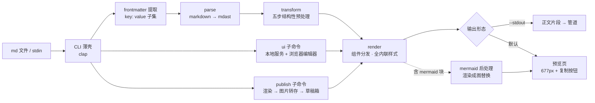
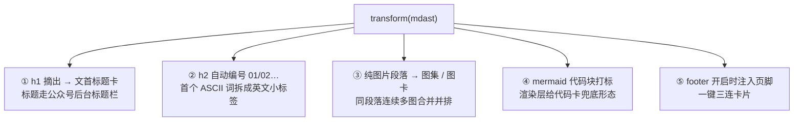
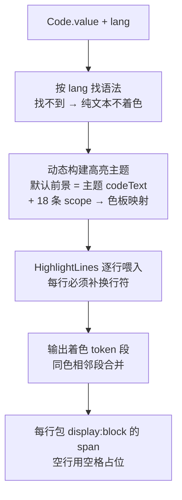
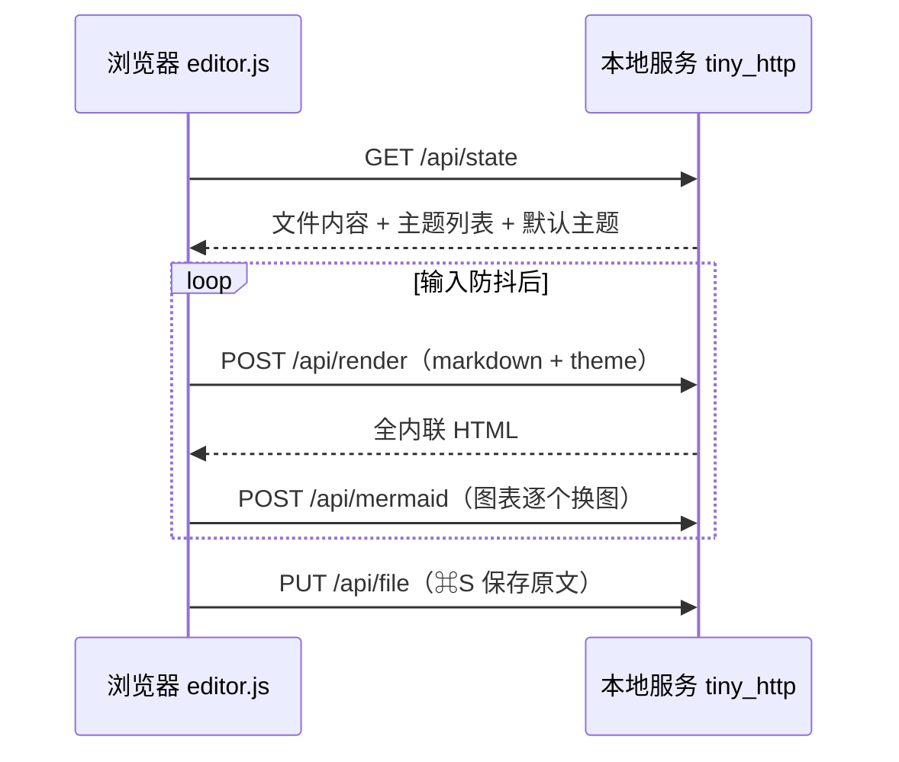
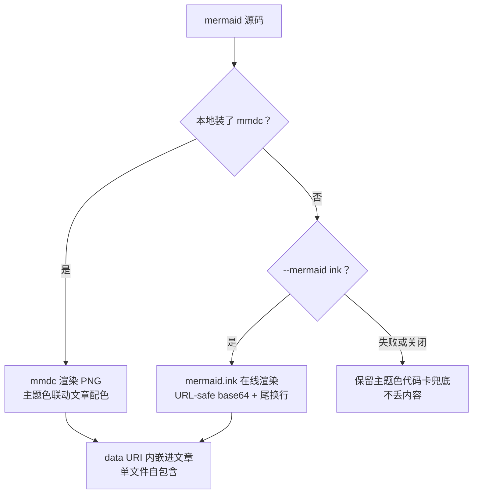
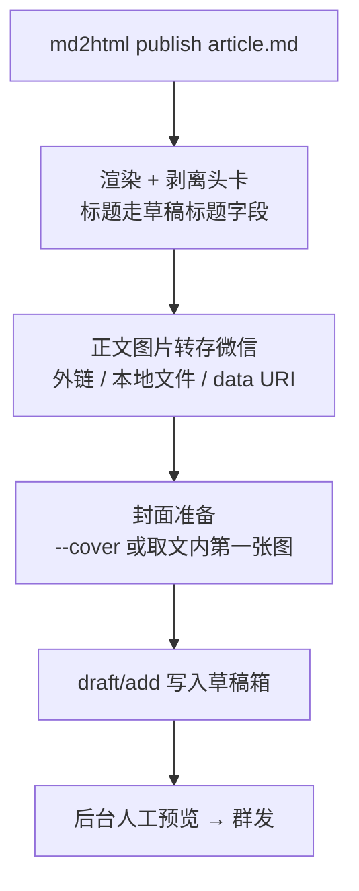

# 一条命令，把 Markdown 排进公众号：md2html 的设计与实现

> 声明：自研学习项目，不构成任何生产系统建议。

写作的最后一公里从来不是写，而是排。

一篇在本地 markdown 编辑器里清清爽爽的文章，粘进公众号编辑器就面目全非：字体被重置、代码块变成一坨纯文本、图片间距错乱、精心写的 CSS 一行都不剩。市面上的解决方案大多是"网页排版器"——在网页里粘贴渲染，再从网页复制出去，多一步操作，也多一次格式损耗。

md2html 把这件事压缩成一条命令：

```bash
md2html article.md
```

产出一份 677px 宽的预览页，点一下「复制到公众号」，富文本进剪贴板，去公众号后台 ⌘V，排版原样落地。甚至还能再进一步：`md2html publish article.md` 直接把文章写进公众号草稿箱。

这篇文章拆解它的设计与实现。文章里所有架构图都是 mermaid——它们会被 md2html 自己渲染成图片内嵌进 HTML，算是自举验证。

## 一、核心思路：三条铁律

公众号编辑器对粘贴内容极其挑剔：`class` 被剥、`<style>` 被删、CSS 计数器和 grid 全部失效、`<div>` 部分客户端会清洗、`<pre>` 会被重置。围绕这些约束，md2html 的 core 只有三条铁律：

1. **core 是纯函数**：`render_markdown(md, options) → { html, theme, meta }`，不碰文件系统，CLI、编辑器、发布三条路径共用同一个入口；
2. **样式 100% 内联**：正文没有 `<style>`、没有 `<script>`、没有 class/id，每一条样式都写在元素的 `style` 属性上；
3. **结构性效果在 AST 层做**：章节编号、图集、页脚必须是真实 DOM 结构，不依赖任何 CSS 特性。

第三条最容易被忽视。比如 h2 自动编号，网页里一行 `counter-increment` 就能解决，但在公众号里只有把它变成真实的 `01`、`02` 文本才活得下来。

## 二、总体架构

整条管线是 `parse → transform → render` 的单向数据流：



三个消费形态（转预览页、浏览器编辑器、发草稿箱）完全共享同一个渲染核，差异只在输入输出壳层。这意味着你在编辑器里实时看到的，和最终发布的，是同一个引擎的同一份输出。

## 三、transform：五步结构性预处理

parse 产出标准 mdast 之后，transform 在 AST 层做五步结构性改写。这一步决定了文章的"骨架"：



几个设计细节：

- **头卡默认渲染、复制时剥离**。标题卡（日期 + 大标题 + 主题色短线）在预览页里给文章一个"封面感"，但公众号的标题走后台标题栏，正文里再放一个大标题就重复了。所以头卡带着 `data-md2html-block="header"` 标记，复制按钮和发布链路都会把它摘掉——预览归预览，粘贴归粘贴。
- **编号在 AST 层做**，而不是渲染层数一遍——因为 h2 还要拆出英文标签。`## WHY 为什么需要它` 会渲染成特大号主题色数字 `01`、灰色小字距标签 `WHY`、黑色粗体标题的横向组合。
- **图集按段落分组**：同一段落里连续书写的多张图合并为并排图集，跨空行的图各自独立成图卡，符合"空行即分组"的写作直觉。

## 四、render：一张组件分发表

渲染层没有模板引擎，就是一张按节点类型分发的组件表：heading/paragraph/list/table/blockquote/code…每种类型一个纯函数，吃 AST 节点和主题变量，吐内联样式的 HTML 片段。

主题系统因此可以极简——**主题就是一份色板数据**：

| 主题 | 主色 | 定位 |
|---|---|---|
| 摸鱼绿 `moyu` | `#07C160` | 微信绿，清爽护眼 |
| 红白色系 `redwhite` | `#E34D59` | 热烈醒目，观点文 |
| 深海蓝 `deepblue` | `#2A6AE9` | 沉稳专业，技术文（默认） |
| 活力橙 `orange` | `#F76B1C` | 明快有食欲，生活文 |
| 暗夜紫 `grape` | `#7C5CFC` | 神秘高级，AI 前沿 |
| 蜜桃粉 `peach` | `#EC6E8B` | 柔软治愈，情感文 |

每套主题只覆盖 10 个语义色（主色、浅底、标题、正文、弱化字、高亮、卡片底、边框、代码底、代码字），字体、圆角、间距全主题共享。渲染器不感知主题，只认语义色——加一套新主题就是加 10 个色值，零逻辑改动。

一个真实的教训：初版主题的弱化色（日期、题注、栏目标签这类 12px 小字用的灰）在白底上对比度只有 2.4~2.7:1，看着"淡雅"，读起来费劲。后来把 6 套主题的 muted 色统一加深到 **WCAG AA 标准（白底 ≥ 4.5:1）**，同时保持各主题的灰调色相、且仍明显浅于正文色——"弱化"是层级，不是"看不清"。

## 五、代码高亮：为什么是逐行 span

公众号会重置 `<pre>`，所以代码块不能依赖任何容器样式，md2html 的做法是把代码拆成**逐行的 `<span style="display:block">`**，每一行内的关键字、字符串、注释再按 token 上色。这样即使编辑器把容器样式全部剥掉，行结构和颜色还在。

高亮引擎用 syntect（Sublime 语法引擎），按主题的代码字色动态构建高亮主题，再把 Sublime 作用域映射到 VSCode Dark+ 风格的色板：



这里踩过一个很有代表性的坑：**逐行调用高亮 API 时，每行必须以换行符结尾**。syntect 的行级 API 靠 `\n` 复位行内解析状态，不补的话，`//` 行注释的"注释态"会跨行延续，把下一行代码整行染成注释色。这类"行级 API 与状态机语义边界"的问题，报错不会告诉你，只有截图对比能抓到。

## 六、浏览器编辑器：本地服务 + 浏览器标签

`md2html ui article.md` 会起一个只绑定 `127.0.0.1` 随机端口的本地服务，浏览器打开就是一个左编辑右预览的编辑器：防抖实时渲染、主题下拉即时切换（记忆在浏览器 localStorage）、⌘S 保存回原文件、一键复制。



因为 Rust 的渲染核跑不进浏览器，预览走服务端渲染——本地回环延迟毫秒级，换来的是编辑器预览与 CLI 产出**严格同一个引擎**，不会出现"预览一套样、发布另一套样"。

复制按钮的细节值得一提：复制时先克隆预览区、摘掉头卡（标题走后台标题栏）、再通过离屏选区把富文本写进剪贴板。粘贴到公众号，正文干净开场。

## 七、mermaid 图表：唯一可靠的形态是图片

公众号不执行 JavaScript，内嵌 SVG 的样式也会被剥。图表想在公众号里活着，只有渲染成位图一条路。md2html 对 `mermaid` 代码块的处理是一条三级降级链：



在线渲染的 API 有几个不起眼但一踩一个准的坑：base64 必须用 URL-safe 变体且去 padding，源码必须以换行结尾否则服务端 400，scale 参数必须配合宽高使用。这些细节都沉淀在代码里，调用方只需要关心 `--mermaid auto | ink | mmdc | off`。

本文的每张架构图就是这么变成图片的——`md2html blog.md --open`，完了。

## 八、一行命令进草稿箱

复制粘贴之外，`publish` 子命令把"发布"也自动化到最后一步之前的最后一步（群发永远手动，这是产品原则）：



凭据从环境变量或 `~/.md2html/config.json` 读取；摘要默认取首段前 120 字；超过 10MB 的图片记入 skipped 清单继续发布，单图失败不阻塞整篇。常见的报错 48001 代表未认证账号没有草稿箱接口权限——错误信息会直接告诉你去开权限。

## 九、公众号白名单：一份实现约束清单

所有渲染决策最终都收敛到一张白名单约束表，这也是 review 每个组件时的 checklist：

- 允许的标签只有 `section / p / span / strong / em / img / table / tr / td / blockquote / br / code`；
- 布局全靠 `<section>` 嵌套加 flex，不用 `<div>`（部分客户端有清洗行为）；
- 代码块必须逐行 `<span style="display:block">`；
- `<a>` 对多数个人号无效，链接降级为主题色加下划线的文字；
- 自定义 `data-md2html-*` 属性只作剥离标记，被公众号剥掉无副作用。

约束越早想清楚，渲染层越干净。md2html 的渲染代码里没有一处"如果是公众号就……"的分支——它生成的 HTML 从第一天起就只面向公众号这一种运行环境。

## 十、工程化：单文件二进制与一键发版

技术选型全部向"单文件静态二进制、交叉编译零 C 依赖"收敛：markdown 解析用 markdown-rs（直接产出标准 mdast）、高亮用 syntect 的纯 Rust 正则后端、HTTP 用 rustls 免系统 OpenSSL。release 构建 LTO + strip 后约 5MB。

CI 在三个桌面系统跑完整测试（单元 + 快照 + CLI 冒烟），打 `v*` 标签自动构建五个平台产物直传 GitHub Release：macOS（x64/arm64）、Windows x64，以及 **musl 全静态的 Linux x64**——CentOS 7、Alpine 这类老 glibc 环境解压即用。这里有个小插曲：Debian 的 musl-gcc 包装器有个 `-m64` 缺陷，编不过 TLS 库里的 C 代码，交叉编译方案整体不可行，最后是 Alpine 容器原生构建解决的。


测试策略上，快照测试承担了主要的回归防线：一份元素齐全的样例 markdown × 6 套主题，结构改动后 `UPDATE_SNAPSHOTS=1 cargo test` 重新生成基准，日常改动跑 `cargo test` 即可人眼零参与地发现排版回归。

## 十一、使用姿势

```bash
md2html article.md                  # 预览页，含头卡
md2html article.md -t moyu --open   # 换主题并自动打开浏览器
md2html article.md --stdout         # 纯正文片段，管道友好
md2html article.md -w --open        # 监听变更实时重新生成
md2html ui article.md               # 浏览器编辑器
md2html publish article.md          # 写入公众号草稿箱
md2html --list-themes               # 查看可用主题
```

支持 frontmatter 元数据：`title / date / theme / header / footer / author / digest / cover`，优先级为 CLI 参数 > frontmatter > 自动兜底。

## 写在最后

回看整个实现，最有价值的决策其实是最早想清楚的那几条：样式全内联、结构性效果放 AST 层、core 是纯函数。它们让后面每一个功能（编辑器、发布、mermaid）都只是在同一条管线上加壳，而不是打补丁。

如果你也在公众号写作，欢迎试试这个工具，也欢迎交流排版路上踩过的坑。
